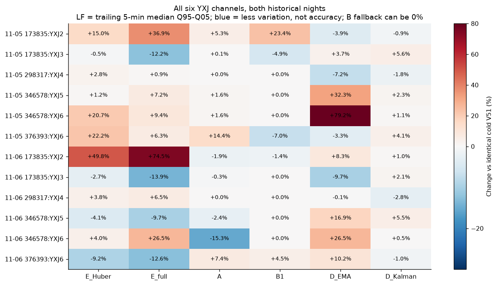
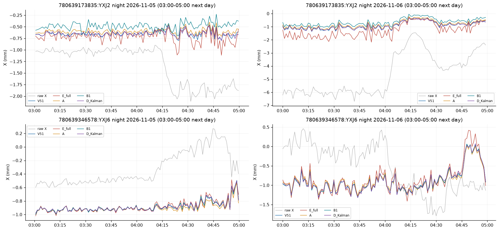
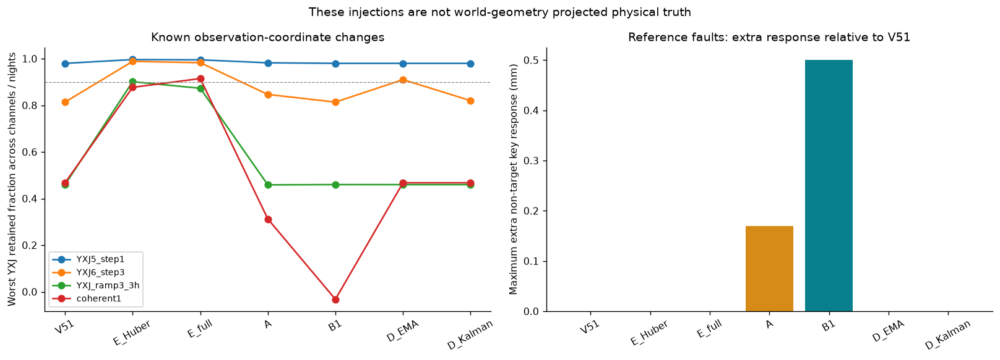
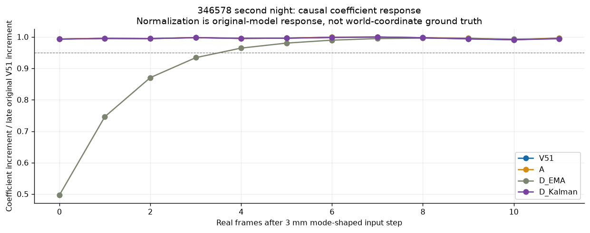

# 证据排序与工程结论

**本轮没有通过全部条件、值得默认启用的 X 增强。研究优先级最高的是 A：保留三阶模态的 YJ 软约束；它对独立参考有收益，但尚未稳定改善关键 YXJ。生产仍应保留原 V51。**

同条件比较只用原始V51独立冷启动，现场calX另列。两夜已被多轮探索，第一夜还经历02点冷启动；所有结论为机制证据和历史开发结果，不是新夜验收，更不是最终X0精度。

## 1. 正常残余与最坏通道

以下均为原V51实际活动帧中的5分钟Q95−Q05，单位mm；斜杠依次为11/05夜和11/06夜。它是观测波动，不是误差。

| YXJ观察通道 | 原V51 | E_full | A软约束 | D_EMA | D_Kalman |
| --- | --- | --- | --- | --- | --- |
| 173835:YXJ2 | 0.2704 / 0.8014 | 0.3703 / 1.3985 | 0.2846 / 0.7864 | 0.2597 / 0.8681 | 0.2679 / 0.8097 |
| 173835:YXJ3 | 0.2510 / 0.3057 | 0.2202 / 0.2631 | 0.2513 / 0.3048 | 0.2602 / 0.2760 | 0.2650 / 0.3121 |
| 298317:YXJ4 | 0.2572 / 0.3139 | 0.2594 / 0.3343 | 回退 / 回退 | 0.2388 / 0.3137 | 0.2525 / 0.3052 |
| 346578:YXJ5 | 0.1322 / 0.1326 | 0.1417 / 0.1197 | 0.1343 / 0.1294 | 0.1749 / 0.1550 | 0.1352 / 0.1399 |
| 346578:YXJ6 | 0.2502 / 0.4407 | 0.2736 / 0.5574 | 0.2543 / 0.3731 | 0.4482 / 0.5572 | 0.2529 / 0.4427 |
| 376393:YXJ6 | 0.1733 / 0.2476 | 0.1842 / 0.2165 | 0.1984 / 0.2660 | 0.1677 / 0.2730 | 0.1805 / 0.2450 |

完整全部YJ/YXJ、两夜、10/30/60分钟变化P99、步差P99、持续偏移及不同实际运行范围见ablation_results.csv。不得只挑本表较好的单元格验收。

## 2. 研究优先级

| 优先级 | 方法 | 支持证据 | 否决或限制 | 实施代价与本轮判断 |
| --- | --- | --- | --- | --- |
| 1 | A：YJ约束v | 独立LOPO的YJ低频范围比值中位数约0.918/0.968；第二夜346578:YXJ6约改善15.3% | YXJ第一夜无通道改善，376393:YXJ6两夜退化14.4%/7.4%；同型运动保留恶化，多参考异常传播 | 3×3小矩阵及参考资格，计算不重；最值得继续研究，**不能启用** |
| 2 | E：Huber及历史/杠杆权重 | YXJ6三毫米阶跃保留改善，部分学习点异常传播减弱；173835:YXJ3两夜低频约下降12.2%/13.9% | 同设备YXJ2反而增加36.9%/74.5%；历史尺度不是纯噪声，权重改变了公共趋势跟随 | 改动局部、代价低；只值得故障影响机制研究，不能全局替换LS |
| 3 | D_Kalman：创新门控 | 无新增YJ故障传播；可辨识大阶跃系数响应0帧；298317:YXJ4两夜低频约下降1.8%/2.8% | 多数结果接近原解，其他关键点退化，未稳定降低残余；不解决共同运动的不可辨识性 | 状态很小，但需状态版本/重启协议；收益尚不足以承担改动 |
| 4 | B1：残余位置项 | 两设备历史独立参考能量检验通过 | 跨夜YXJ不稳定；单参考异常额外伪响应约0.167 mm，多参考约0.500 mm；坐标语义缺失 | **失败，不进入工程** |
| 5 | D_EMA：因果平滑v | 满足约5帧限制，部分通道LF变小 | 346578:YXJ6第一夜LF约增79.2%、第二夜增26.5%；快速硬件扰动跟随不足 | **失败**，不能以延迟合规或个别平滑收益为理由启用 |
| 不作效益排序 | B0/B2、C | B0/B2资格筛查、C数学设计完成 | B0与现有模态重合；B2参考不足或历史LOPO失败；C只有一份因果历史可供第二夜用 | 停用或证据不足，回退不能算“稳定成功” |

A的LOPO只从当前约束移除目标，仍用已有历史载荷；第一夜有一参考LOPO低频比值约1.124，未掩盖。YJ多数改善而YXJ不稳定，说明“把参考修得更平”仍不等于目标串联输入改善。现有证据更指向**固定历史载荷与当前各类观测响应不完全一致、参考/目标信息分工**，而非单纯逐帧系数噪声。此为机制推断，未证明生产现场唯一根因，更未证明应立即更改ModesFrom。

## 3. 位移和参考异常注入的否决证据

完整矩阵包括所有通道和1/3 mm、1/3小时等形态，不仅选最好的注入。图中的已知输入属于观测域，未经真实串联几何投影。

- **A的单YJ隔离有作用，但不充分。** 单参考1/3 mm变化的最大额外关键点响应约0.051/0.066 mm；多参考共同变化可到0.170 mm。173835:YXJ2参考与目标同型+1 mm时，A稳定段仅保留约0.313，原V51约0.468。
- **B1直接失败。** 单参考异常可额外影响关键点约0.167 mm，共同参考异常约0.500 mm；同型+1 mm在173835:YXJ2出现约−0.032的反向保留率。历史独立拟合通过不足以保证当前安全。
- **E的权重有保护特定输入形态的效应。** 同型+1 mm在最差YXJ中，E_Huber约保留0.877、E_full约0.915，优于原V51约0.468；但它们对正常YXJ2残余的严重退化仍否决全局启用。不能将这种观测形态保留率宣传为真实沉降精度。
- D不使用YJ，因此YJ故障不额外传播；但继承原LS把某些共同形态当模态吸收的不可辨识风险。
- 所有候选Y与独立原V51在相同输入场景下逐位一致，包括Y向−1 mm形态；不是宣称原V51可以保留任意真实沉降。
- 参考及学习点失效恢复、所有非目标点伪响应另列，原模型失败帧仍原样回退。没有靠增加硬剔点比例换取平滑。

可辨识模态阶跃的EMA最多4帧到95%，Kalman为0帧；没有把333715未定义的模态形状测试计为0延迟通过。时延合规并不能消除EMA的残余增大。

## 4. 设备适用与回退

| 设备 | 研究资格和证据 | 工程结论 |
| --- | --- | --- |
| 173835 | 3个YJ通过历史资格；A对YJ有收益；B1一维代理可估；E对YXJ2最明显退化 | 保留原解。不能因为YXJ3或YJ改善而启用全设备增强 |
| 298317 | 无本地YJ，A/B严格回退；Kalman的YXJ4小幅两夜收益 | 没有足够新夜证据建立设备白名单 |
| 333715 | 无本地YJ/YXJ，完整原始点及系数/Y控制仍执行 | A/B回退；不能虚构参考或最终串联改善 |
| 346578 | A在第二夜YXJ6有15.3%局部收益，第一夜未复现；空间一/二维历史LOPO负收益 | 最值得继续核对参考创新与YXJ载荷的设备，但目前回退原解 |
| 376393 | A的YXJ6两夜均退化；B1异常传播失败 | 不能按“YJ很一致”直接启用约束或空间补偿 |
| 414923 | 有3个历史合格YJ，无本地YXJ；空间增量与已有模态重合 | 参考自洽性可诊断，不能从无YXJ观察推断串联收益 |

## 5. 下一轮最小改动

最有依据的继续路线是**X轴可选的三阶YJ约束求解路径**，保留原始SolveV、ModesFrom、历史学习及Y。先作为可回退影子路径，输出v0/v、每点新增修正、独立YJ预测及参考拒绝原因；不要默认启用本轮固定参数。

下一候选必须先解决：当前多参考共同异常与真实同型运动的混淆、参考改善向YXJ传播时的影响保护，以及376393退化。单纯增加参考权重、延长平滑或全局改历史权重没有本轮支持。稀疏异常的鲁棒求解可作辅线，不能因注入保留较好就忽略173835:YXJ2的正常退化。

现有三阶模态总体有效，本轮不推翻它。没有方案满足全目标时，**本轮最小生产算法改动为零**；研究实现已提交，可供审查，而不是把缺乏收益的改动塞入生产。C待历史充足，新夜读取前冻结所有模型/阈值；未来若获得真实串联求解、标定和独立真值，再验证同输入最终X0，当前未生成这种结果。
