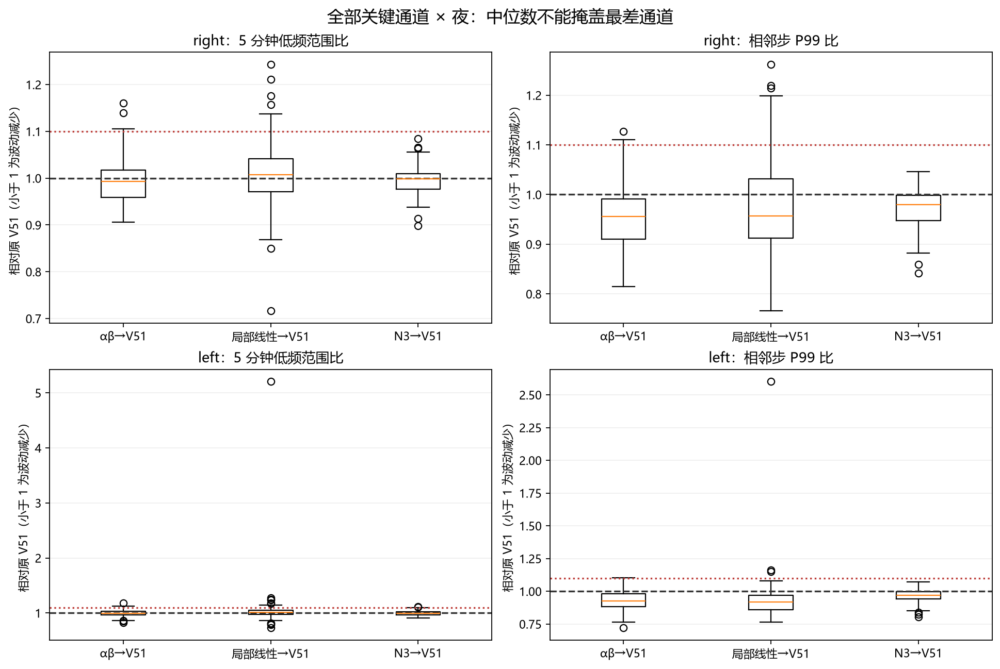
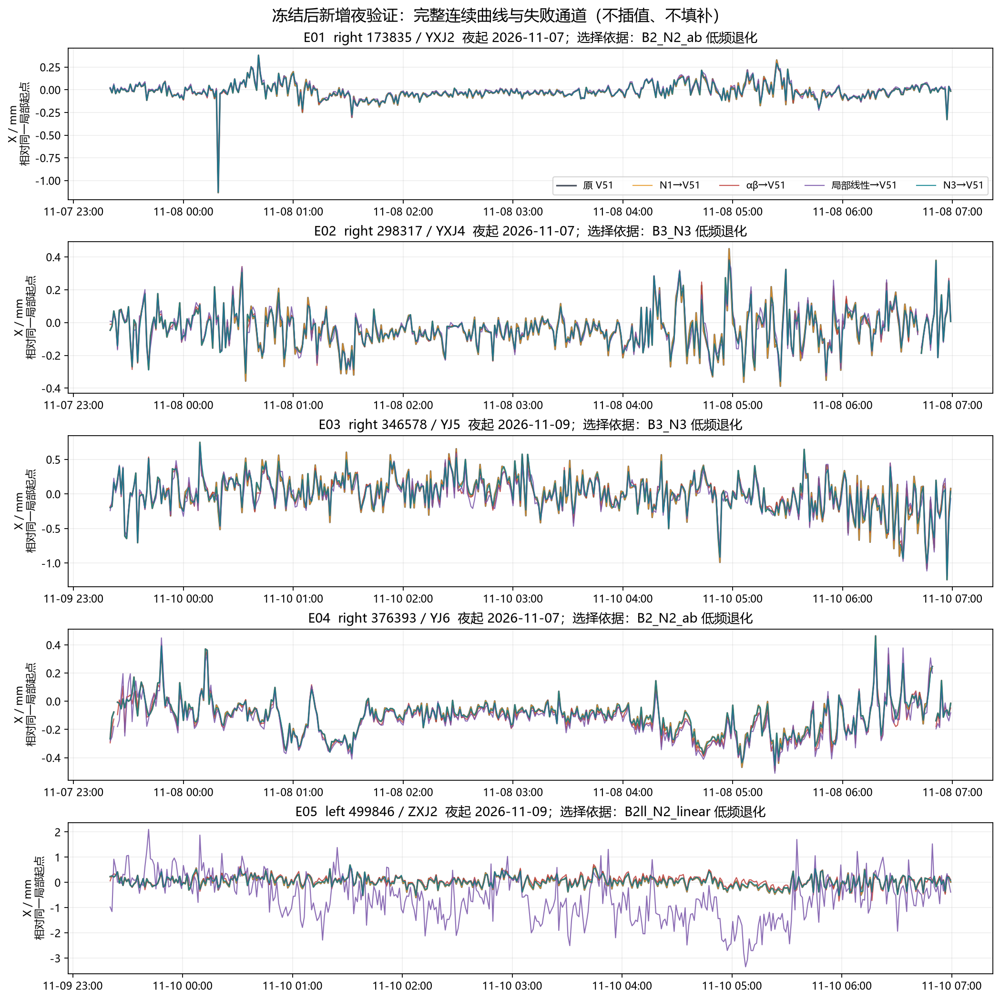
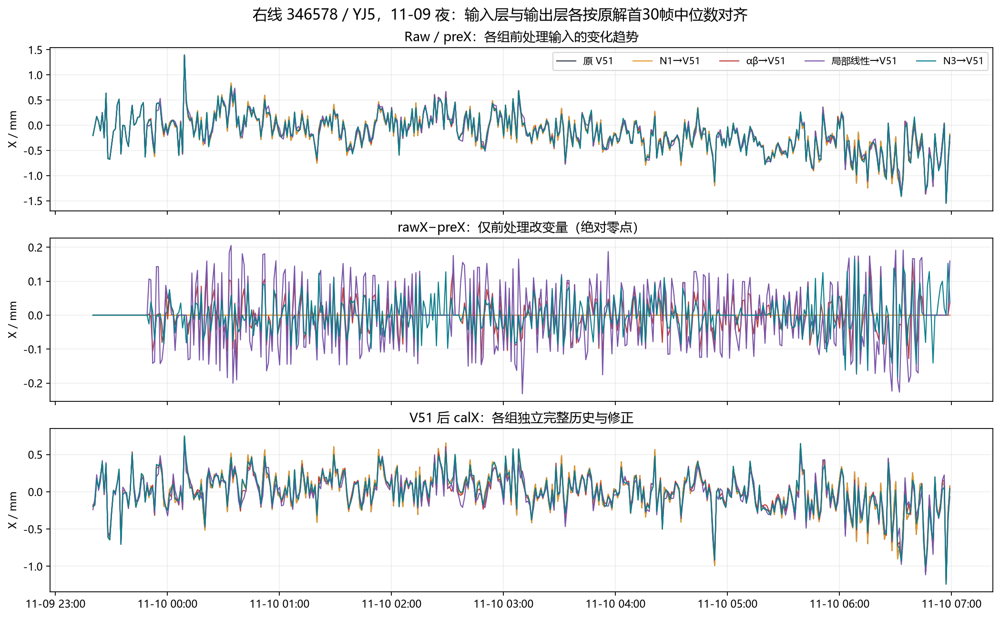
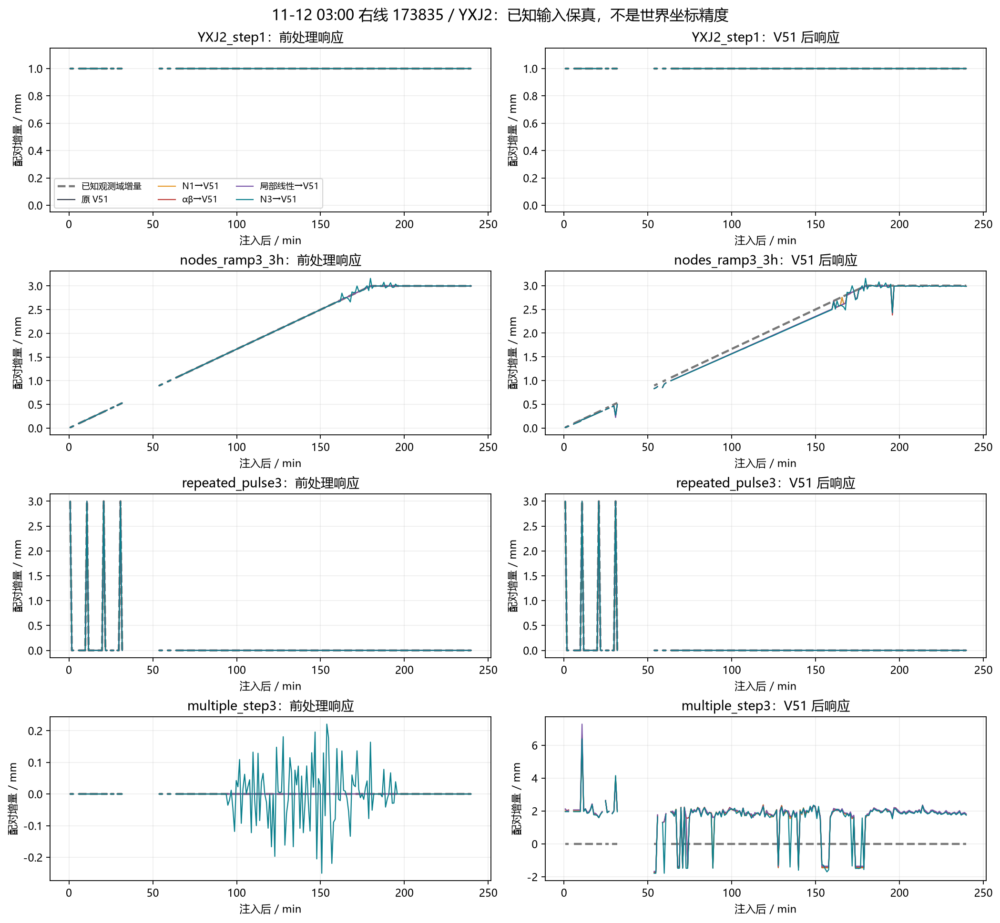

# 前置 X 降噪是否真正帮助原 V51？

**结论：存在小幅、受控的随机噪声抑制，但尚不能同时保证公共扰动识别、关键通道低频稳定和真实变化保留。当前没有值得直接启用的前置方案。N3 是相对保守的后续研究方向，生产最小改动为零。**

本轮保留原 V51 完整核心与配置。右线 11/05–07 为已探索开发集；实现冻结后首次读取新增 X/Y，验证 11/07–11/11 五个完整右线夜，另用左线作迁移检查，数据到 11/12 上午。所有分支独立建立基线、学习统计和历史。这里的“新增夜验证”是对本轮冻结实现的离线封存检验，不是未来现场验收；左线也使用原 V51 作为实验基线，不冒充现场 V53 的精确复现。

## 1. 有随机样成分，但它不是主要残余的完整解释

旧数据中 YJ / YXJ / 普通点的残余增量 lag-1 相关中位数约 -0.48 / -0.45 / -0.43，支持短时随机样抖动存在；原始步差与原 V51 共模修正步差也有较强关联。共同运动、空间响应差异、慢漂移与独立抖动同时存在，无法把全部高频都当噪声。

只有约一分钟采样，不能推断提点原始帧率的高频谱。没有像素真值及实际落库变换，不能证明 ±1 pixel。详细证据及 SDK 单位边界见 [noise_identifiability.md](noise_identifiability.md)。

## 2. 关键通道结果：收益小，最差通道必须保留

指标为原 V51 实际活动帧中，逐关键通道/逐夜的范围或步差，再取比值的中位数和最大值。小于 1 只代表该波动减少。右线 20 路 YJ/YXJ × 5 夜=100 通道夜；左线 18 路 ZJ/ZXJ × 6 个可用夜=108 通道夜，11/06 夜缺失。

| 方法 | 右线 LF 范围比：中位/最差 | 右线步差 P99 比：中位/最差 | 左线 LF 最差比 | 判断 |
| --- | --- | --- | --- | --- |
| N1 | 1.000 / 1.000 | 1.000 / 1.000 | 1.000 | 正常数据基本透传，没有关键通道收益 |
| N2 αβ | 0.993 / 1.160 | 0.956 / 1.127 | 1.182 | 有短时收益，低频及个别步差退化 |
| N2 局部线性 | 1.008 / 1.243 | 0.957 / 1.262 | 5.205 | 失败，不值得工程化 |
| N3 | 0.999 / 1.085 | 0.980 / 1.046 | 1.111 | 增量较小，但低频改善近于零且仍有失败证据 |

仅看右线六路 YXJ，N3 的 LF 中位比 0.993、步差中位比 0.972；最差分别 1.065 / 1.024。不能把这组小幅结果推广成最终串联位移精度改善。旧开发夜 N3 的单个 YJ LF 仍退化 13.9%，左右线也未形成一致全目标收益。

具体连续反例（完整原分辨率 CSV 见 [event_index.csv](event_index.csv) 与 `windows/`）：

- 右线 376393:YJ6，11/07 夜：αβ 的 LF 从 **0.3055→0.3544 mm（+16.0%）**。
- 右线 346578:YJ5，11/09 夜：N3 从 **0.5506→0.5974 mm（+8.5%）**，步差下降并未同时改善低频。
- 右线 298317:YXJ4，11/07 夜：N3 LF **0.2091→0.2228 mm**，步差有所降低。
- 左线 499846:ZXJ2，11/09 夜：局部线性 LF **0.4166→2.1686 mm**、步差 P99 **0.7918→2.0594 mm**。该夜学习点从18变15，子空间最大夹角约15.36°；输入前处理改变了原模型的学习资格和历史统计，不能只检查即时 preX 是否平滑。

## 3. 已知随机误差：能减小，但有条件且不稳定

在同一真实序列上加入固定的独立 Gaussian 增量，σ 为 0.03478 / 0.06956 / 0.13911 mm，各组从首帧重建全部历史，比较各自 `输出(x+ε)-输出(x)`。这叫**配对已知扰动敏感性**，不是现场绝对误差。

右线按点、三种噪声等级合并各夜后，cal 敏感性相对 B0 的中位比：N1=1.000，αβ=0.970，局部线性=0.995，N3=0.959。N3 对右线 YXJ 的逐通道夜中位比，在三个等级分别为 **0.993 / 0.965 / 0.941**，低噪声端收益很小；该端最坏 YXJ 反而为 **1.193**。αβ 在最低噪声端 YXJ 中位比 **1.054**，说明资格切换和历史学习耦合可放大小扰动的输出差。

完整逐点结果见 `noise_sensitivity_*`，逐夜分布见 [noise_night_overview.csv](noise_night_overview.csv)。不能只选较高噪声等级展示成功。

## 4. 幅度保住，不等于整条链路安全

右线新增夜的 N3 前处理，对24个单 YXJ 1/3 mm 阶跃目标测试，稳定段保留率约 **1.000000–1.000004**；1–3小时斜坡的最大斜率偏差约 **0.325%**。这支持其前处理层较温和。左线对应斜率偏差可到0.630%，且存在额外8帧的95%阶跃响应延迟，超过本轮约5帧筛选约束。

但完整 V51 后，N3 右线单点阶跃保留率仍为 **0.329–1.001**；原 V51 自身约 **0.329–1.001**。不是前处理把所有运动保存了：局部输入与模态形状重合时，原核心本就可能吸收变化。沿原模态的共同阶跃几乎被原 V51 全部抵消，候选继承了这一可辨识性限制。**本轮不把它解释成真实物理沉降必然会被抵消，也不把它隐藏。** 注入未经串联几何投影。

更直接的否决证据：11/12 03:00，173835 每隔一个点施加3 mm阶跃，YXJ2自身未注入。03:59:44.833，原 V51 的配对 cal 响应 **+1.3423 mm**，N3为 **−1.7849 mm**，额外非目标响应 **3.1273 mm**。这一帧 N3 前处理已透传（changed=0、common_qualified=0），但两路历史模型不同，SolveV使用点数由原路15变为候选16。说明**当前增量正交、当前透传，都不能保证完整历史链路不改变后续原求解的拒点与传播**。该机制是算法压力测试的已确认结果，不能替代现场几何因果解释。

αβ 在同类压力测试中也出现约3.06 mm额外非目标关键响应。N3 右线单点阶跃的额外波形 RMSE 可到0.096 mm、多点阶跃可到0.290 mm；cal达到已知阶跃95%的额外时间有17帧案例。最终幅度未保留时延迟留空，不计作0帧通过。普通脉冲、参考异常、共同参考异常、缺失恢复和连续反向跳变也全部列出，没有只展示保真的阶跃。

证据：[signal_safety_overview.csv](signal_safety_overview.csv)、`waveforms/`、[extra_nontarget_key.csv](extra_nontarget_key.csv)、[多点阶跃连续证据](windows/injection_multiple_step3.csv)。额外非目标量逐帧先减各方法未注入输出，再减 B0 配对响应，最后取最大值，**不是两个最大值相减**。`injection_non_target_*` 则是包含原有传播的全点最大量，两者口径不同。

## 5. 对学习和求解的影响

右线新增五夜，αβ有3个设备夜、局部线性有5个设备夜改变学习集合；N3没有改变集合，但最大子空间夹角仍约4.26°。左线局部线性改变2个设备夜的集合。完整全日/夜窗口中，右线局部线性 DEGRADED_FRAME 从原解8帧增至19帧；其余本批与原解相同。候选的模态系数必须在各自基底中解释，不能把旋转后的 v 逐阶直接作物理增益比较。

N3 固定影子子空间投影的最大数值泄漏约1.1e-16，满足实现约束；但这不构成完整链路稳定性证明。其资格还要求所有学习点有效、无原拒点，因此很多帧回退；全日窗口约31%帧符合公共模型处理条件，不能把其余帧当降噪成功。逐帧证据见 `mode_trace_windows*`，学习变化见 `mode_stability_*`，CPU与退化见 `coverage_runtime_*`；`runtime_full_stream.csv`另保留包含22–02点建模在内的全流主调用median/P99/max，避免用P99漏掉极少量建模峰值。

全部原始、三种噪声全历史回放及所有形态续跑，Y均与独立原 V51逐位相同；原 V51/V53文件哈希、冻结实现及只读数据库SHA均通过核验。缺少完整串联接口和几何，没有生成候选X0。

## 6. 工程选择

1. **不启用本轮任何前处理，不组合B4。** N1与N3在旧数据上未达到预定独立收益条件，新增夜也未用于重新选择组合。
2. 若继续研究，N3优先于直接αβ/局部线性，但先解决“独立预处理历史改变原拒点与异常传播”的风险。其微小步差收益不足以覆盖新增影子核心、状态版本、延迟及压力测试代价。不能根据新增夜再调阈值后沿用本轮封存验证名义。
3. 最小可实现工作为**仅记录的可选影子模块**：raw/pre/cal、两层修正量、点序/有效性、模式指纹、拒点集合与Y校验；实际输出仍原V51。若再提出新候选，要在下一未读夜前重新冻结，并用独立观测或标定台架区分随机提点误差与真实局部运动。
4. 获得真实串联条件后，再验证同输入X0及节点灵敏度；在此之前，不以cal曲线更平宣布工程目标已达成。

因此对最终问题的回答是：**前置处理能对某些已知随机增量略微降噪，但目前不能证明它在保留公共识别与真实趋势的同时，让原V51获得可靠、全目标更稳定的输出；强平滑或只展示均值会掩盖真实失败。**
