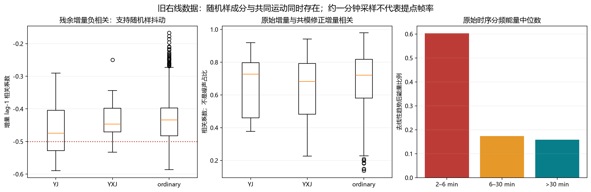

# 随机样变化、公共运动与真实位移的可辨识边界

## 前序证据与本轮定位

已复核 PR [#1](https://github.com/Wizcoo/gzmetro-modal-selfcal/pull/1)、[#2](https://github.com/Wizcoo/gzmetro-modal-selfcal/pull/2)、[#3](https://github.com/Wizcoo/gzmetro-modal-selfcal/pull/3) 的结论、指标、连续数据与脚本：

- PR1 区分 raw/cal、filtered/init 和实际 x0；字段名不能替代业务公式，初值跳变不能算共模失效。
- PR2 证明 YJ 及 YXJ 具有公共变化信息，但跨设备/跨夜方向及比例可变；YJ1–4 等物理参考不是同坐标同增益的标签。
- PR3 原始源码冷启动证明 V51 核心有效，修改系数、参考约束或时序状态未获得全部关键通道稳定收益。本轮不再改 K、前缀或 SolveV，而研究输入侧的有限改动。

原始链路证据见 [PR1 pipeline_trace](../right_x/pipeline_trace.md)，参考绑定关系见 [PR2 findings](../right_x_yj_yxj/findings.md)，前轮失败机制见 [PR3 ranking](../right_x_enhancement/ranking.md)。YXJ 观测设备与被绑定设备不合并成一条曲线；没有串联几何，不推断候选最终 X0。

## 能观察什么

数据库约一分钟一条观测。只能研究分钟尺度的相邻变化与低频趋势，无法测量视觉算法原始帧率处的高频谱，也无法证明 ±1 pixel。

本轮旧数据的逐点表 `old_noise_components.csv` 分别保留 raw 相邻步 P99、raw/原始 V51 残余增量 lag-1 相关、残余与其他点中位增量相关、raw 与原共模修正增量相关、二阶差分尺度代理。`old_spatial_common.csv` 给完整空间帧的前三 PCA 能量；`old_frequency_components.csv` 在连续近一分钟采样片段中去线性趋势、Hann 加窗，描述 2–6 / 6–30 / >30 分钟的能量比例。**这些比例不能解释为独立噪声、硬件扰动或真实位移的概率/占比。**

独立白噪声叠加缓慢趋势时，增量 lag-1 相关常接近 -0.5，因此负相关与短时回返支持随机样抖动的存在；同时多个点相关、低秩空间能量和原模态修正相关又说明公共变化显著。两种成分共存，不能仅用时间频带把它们完全分开。空间 PCA 也会包含共同真实运动、比例不一致的姿态响应及局部事件。

YJ/YXJ 单列，普通点只作空间和统计对照。346578 的 YJ 响应更复杂；173835 的 YJ 一致性较强仍有低频残余。未知局部运动、共同硬件变化和物理基准观测几何变化都可能进入这些残余。白天用于对照和完整状态回放，**不当作静态真值**；旧 11/05 白天已按显著观测变化前后拆开描述。

## 像素到毫米：可核实的接口，未核实的实现

本地主工程 SDK `Dot2DDIC_V0.0.0.51(1)/Dot2DDIC.h` 的 RoiResult 定义：第136行 `uv_cal` 为像素位移，第137行 `uv_temp` 为温度修正后的像素，第138行 `uv_corre` 为参考修正后的像素，第139行 `fkxy` 为标定系数，第140行 `uv_mm` 为实际毫米位移。124–128行提供 ROI 中心坐标接口；Region 中心注释是图像坐标。相机配置还包含焦距和像元尺寸。

但当前无法访问 DLL 内部、现场数据库写入及其逐字段接线，不能确认 `Marker.x` 究竟由上述哪一输出写入、`scale` 如何参与、是否各轴同尺度，以及 center 是否恒定 ROI 中心或跟踪位置。历史文档的 `pixel≈center+mm·scale` 只能提供线索，**不是本批实际变换的证明**。本轮 x/pre/cal 的毫米标注沿用 V51 公共 API 契约；center/scale 保留原值并标注语义未验证，不转换出像素误差，更不声称达到 ±1 pixel。

## 可证明的实验结论是什么

对同一真实序列 x 加入固定、已知的独立 ε，比较 `F(x+ε)-F(x)`，可以测量对这一已知噪声的敏感性。每组从第一条输入重建自身基线和全部历史，ε 在所有方法间完全相同。它不是现场随机噪声真值，也不是绝对精度。小扰动改变资格/学习模型时，其配对输出敏感性甚至可能比 raw 更大。

对已知阶跃、斜坡、脉冲及共模型增量作同条件续跑，可以证明对这些**观测域形态**的响应、延迟和额外伪响应。共同真实位移如果落在 V51 的扰动子空间中，原 V51 已可能吸收；前处理不能凭空恢复真实物理含义。比较候选对原 V51 的额外失真与原 V51 自身的保留率，二者必须同时报告。

因此，本轮能回答前置处理是否有受控噪声收益、是否恶化已有波形及关键通道；不能把“更平滑”提升为真实沉降准确度，不能以未获得的串联条件替代最终 X0 验证。
