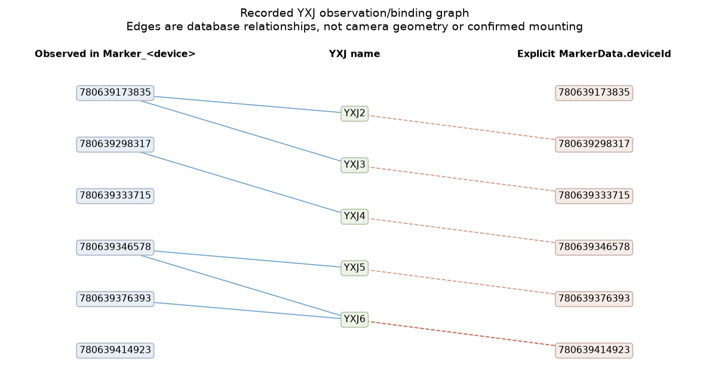
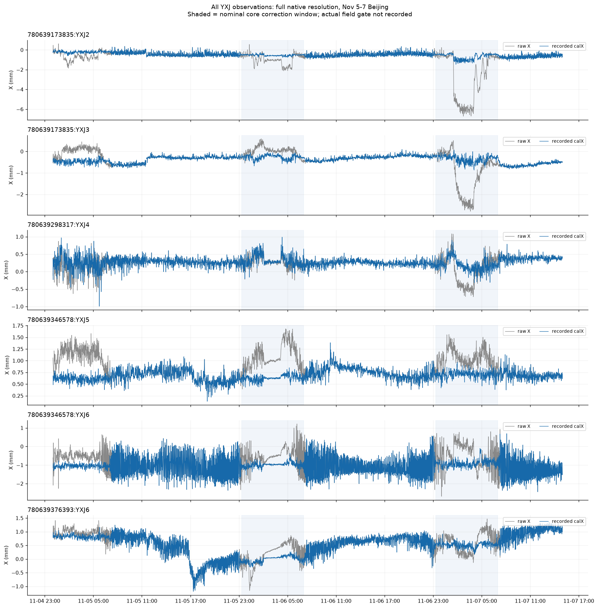
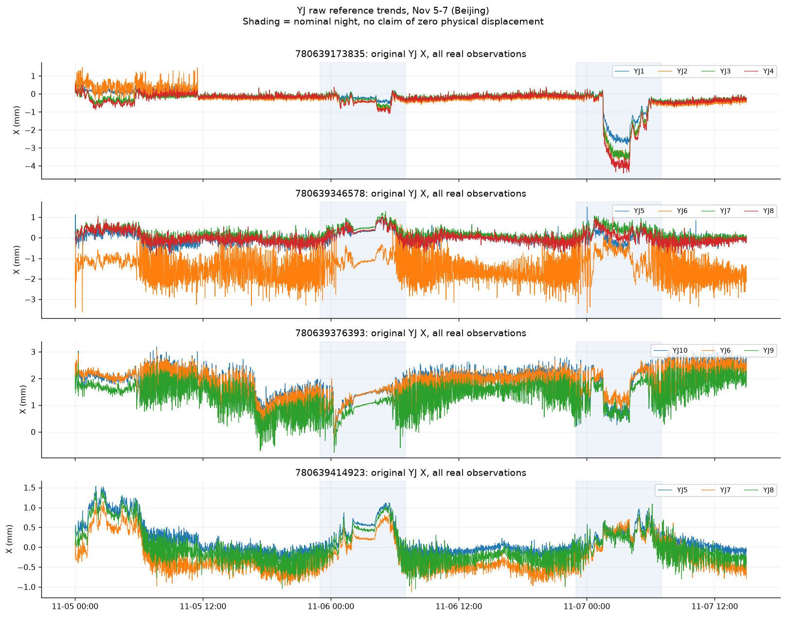
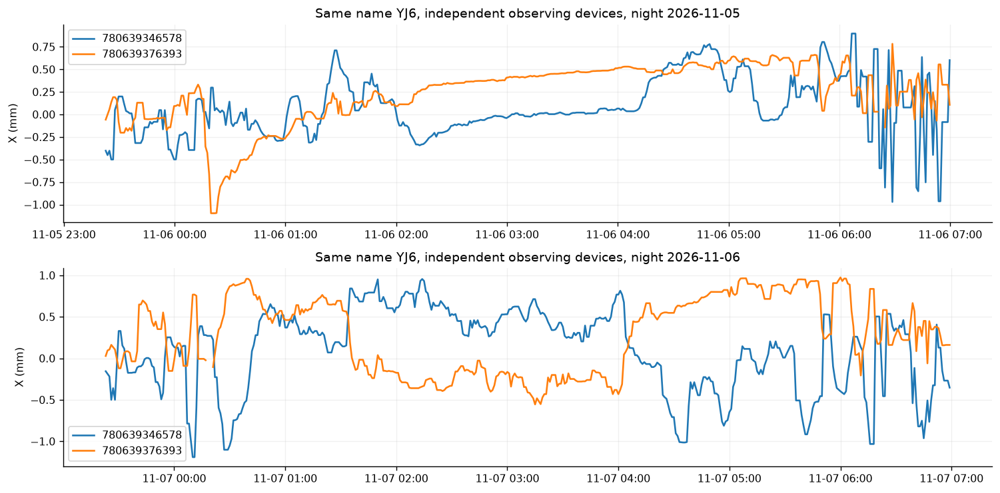
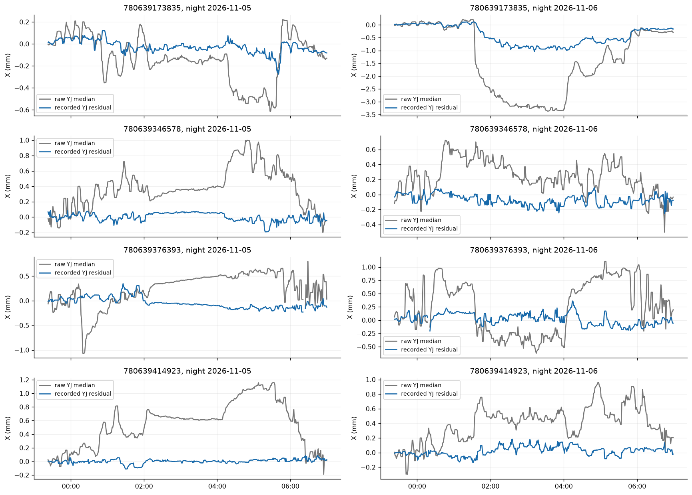
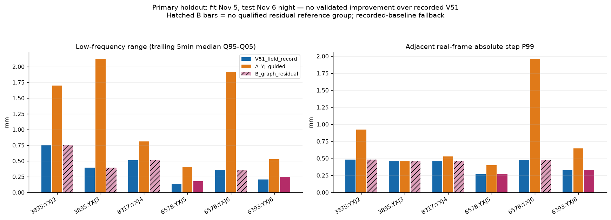
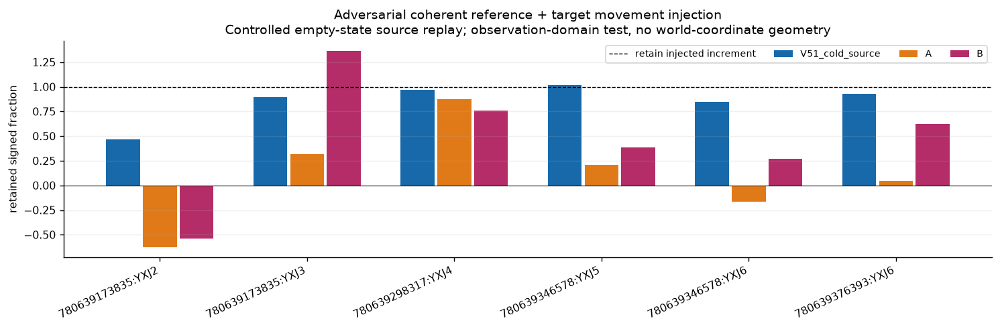

# 右线 X：YJ 引导与 YXJ 设备关联研究

**本轮结论：YJ 确有可用的公共扰动信息，YXJ 也有明确的跨设备观测/绑定关系；但现有两夜还没有证明本轮 YJ 引导候选能稳定优于实存 V51，更没有证明最终串联 X0 精度提升。** 不能直接取消 YJ 的 fit_only，也不能把所有 YXJ 都改成 fit_only。优先研究“观测设备各自的扰动分量 + 节点关联”，避免把 YXJ 当成应被压平的静止靶标。

研究基于 PR #1（6f6784de1ac5514436ade29f1dd933a76f5cd621），不再把普通 YD 单点作为首要优化对象。本轮没有修改 V51/V53、现场状态或生产配置；所有候选仅为离线派生结果，Y 输出保持基线。

## 1. 工程认识与可证明的关系

- 接受项目负责人的工程说明：YJ 是物理基准点，其变化通常可提供设备扰动参考。**物理基准稳定，不等于不同相机看到它时原始 X 必须同方向、同比例。**
- 完整右线窗口为北京时间 11/05 00:00–11/07 15:00，实际末条到14:59。共14路YJ观测（10个名称）和6路YXJ观测（5个名称）；全部有效与无效标识、真实时间戳和源 rowid 均保留，不随机抽样。
- 173835 观测 YJ1–4；346578 观测 YJ5–8；376393 观测 YJ6/9/10；414923 观测 YJ5/7/8。298317、333715没有本地YJ，不能假设六台都能独立作本地YJ补偿。
- X 原始/修正字段单位沿用共模API的毫米契约；当前数据库写入与串联几何实现仍不可得。scale/center等原生列不作为已确认毫米位移。

| 观测设备 | YXJ | MarkerData 明确绑定设备 | 证据边界 |
| --- | --- | --- | --- |
| 780639173835 | YXJ2 | 780639298317 | 同名观测与非空deviceId，不是已知几何 |
| 780639173835 | YXJ3 | 780639333715 | 同上 |
| 780639298317 | YXJ4 | 780639346578 | 同上 |
| 780639346578 | YXJ5 | 780639376393 | 同上 |
| 780639346578、780639376393 | YXJ6 | 780639414923 | 两个观测通道，不能合成一个样本 |

这些关系支持“YXJ可能承载相机/设备节点传递信息”的工程假设，**不能仅凭字段绑定证明实际安装在相机上**，也不构成串联解算的观测方程或Jacobian。YXJ2/3的下游x0恒零，没有可用于精度验收的变化信息。

## 2. YJ 信号：同设备常有强共模，但不能盲目跨夜转移系数

表中是各设备YJ两两原始X在5分钟尾随中位数上的相关系数中位数；不是独立样本统计显著性，也不是物理误差。

| 观测设备 | 11/05夜 | 11/06夜 | 11/07白天 |
| --- | ---: | ---: | ---: |
| 780639173835 | 0.978 | 0.998 | 0.961 |
| 780639346578 | 0.815 | 0.504 | 0.328 |
| 780639376393 | 0.981 | 0.984 | 0.976 |
| 780639414923 | 0.988 | 0.869 | 0.917 |

- 173835、376393、414923的夜间原始YJ共模很强；346578第二夜的YJ关系明显更复杂，不能强行压成一个共同趋势。11/05白天按观测变化前、过渡、后分别统计；白天不当作静态真值。
- 同名YJ跨设备的经验关系也会变化：346578↔376393的YJ6，原始相关从 **+0.226** 变成 **−0.652**；这可能反映观测设备自身不同的运动/姿态分量，不足以断言物理基准点移动或几何关系改变。
- **高相关不保证响应比例稳定。** YXJ2相对本地YJ1：相关0.918→0.968，但斜率3.266→2.309；376393:YXJ6相对本地YJ10：相关0.941→0.912，斜率1.056→0.506。第一夜的固定比例不宜直接当下一夜的工程补偿系数。
- 346578:YXJ6与376393:YXJ6的原始关系：相关 **+0.422→−0.647**，斜率 **+0.503→−0.374**。强制两条曲线同向、等幅或彼此相减，会引入未经验证的坐标假设。
- 可见scale列在训练/验证夜的取值另有逐通道审计；完整标定身份未知。不能把这些经验斜率当成真实标定或串联传递增益。

## 3. V51 已消除大部分 YJ 公共变化，但还有残余

例如11/06夜，YJ完整帧的PC1标准差：173835由 **2.579降至0.789 mm**，376393由 **0.972降至0.232 mm**，414923由 **0.446降至0.157 mm**；346578由 **0.625降至0.360 mm**。这些是观测变化量，不是相对物理真值的准确度。
173835的YJ中位轨迹仍存在约1.01 mm的低频Q95−Q05范围，说明参考残余有排查价值；但残余在不同设备、夜晚并不总是同一方向和比例。不能仅因还有残余就把它全部回归到YXJ上。

白天与夜间同口径比较见 [公共变化幅度表](day_night_common_comparison.csv)。11/06白天及11/07白天，这些YJ的raw与cal逐值一致（容差0.0002 mm）；这是透传的输出证据，仍不能恢复完整gate状态。下表为逐点减窗口首10帧中位数后、设备YJ中位轨迹的5分钟Q95−Q05范围，mm：

| 设备 | 11/06白天raw | 11/06夜raw | 11/06夜cal残余 | 11/07白天raw |
| --- | ---: | ---: | ---: | ---: |
| 780639173835 | 0.2624 | 3.4382 | 1.0108 | 0.2191 |
| 780639346578 | 0.4308 | 0.6925 | 0.2203 | 0.2807 |
| 780639376393 | 0.8902 | 1.4140 | 0.3300 | 0.8791 |
| 780639414923 | 0.2929 | 0.7954 | 0.2097 | 0.2921 |

173835第二夜的残余公共变化仍明显大于相邻白天，但其余设备的夜间残余可小于白天原始变化。白天有不同工况及真实位移可能，不能将上述差额直接当噪声误差或验收线；11/05三个白天分段及两夜均完整列在CSV中。

## 4. fit_only 的真实含义与源码消融

依据 [默认前缀配置](../../versions/V51/ModalSelfCal.h#L36)、[SetNames前缀识别](../../versions/V51/ModalSelfCal.cpp#L381-L386)、[ModesFrom学习及回归](../../versions/V51/ModalSelfCal.cpp#L458-L522)、[SolveV](../../versions/V51/ModalSelfCal.cpp#L530-L558) 和 [逐点输出公式](../../versions/V51/ModalSelfCal.cpp#L869-L875)：
- `:383-386` 按前缀识别fit_only；`:458-469` 的base学习点排除它们；`:530-558` 的SolveV只用learn点。因此YJ不能直接约束特征模态或当前v估计，存在信息利用上的限制。
- 但YJ并没有被整体忽略：`:509-522` 为eligible的非学习点回归载荷，use可以仍为真；`:869-875` 仍可输出补偿。现有YJ曲线明显收敛也与此一致。
- `YXJ` 不以 `YJ` 开头，故默认不在fit_only前缀里；它只是**有资格成为普通学习候选**，是否实际进入learn还受有效率、spread/guard和特征值影响，不能仅凭前缀认定每个YXJ都在驱动v。

另做了受控源码冷启动消融（不是现场精确回放）：默认V51、仅X输出采用“允许YJ学习”的变体、仅X输出采用“YXJ改为fit_only”的变体。全部使用同一数据、初始空状态和原始源码；变体Y输出始终取独立默认V51实例。第二夜只使用此前已形成的历史，不用第二夜结果选参。

| 观测通道 | 默认冷启动低频范围mm | 允许YJ学习mm | YXJ改fit_only mm |
| --- | ---: | ---: | ---: |
| 780639173835:YXJ2 | 0.8002 | 0.6323 | 1.9851 |
| 780639173835:YXJ3 | 0.3057 | 0.3888 | 0.3714 |
| 780639298317:YXJ4 | 0.3139 | 0.3139 | 0.3359 |
| 780639346578:YXJ5 | 0.1326 | 0.1343 | 0.1389 |
| 780639346578:YXJ6 | 0.4407 | 0.3597 | 0.6065 |
| 780639376393:YXJ6 | 0.2476 | 0.2667 | 0.2677 |

**允许YJ学习只改善2/6路的这个低频指标；YXJ全部改fit_only则6/6路这个指标变差。** 这不能证明当前设计最优，却足以否定“直接全局切换就会更好”的假设。
冷启动结果与现场记录并不相同，最大参考通道差约1.333 mm；原因可能包括缺失的历史状态或配置。源码消融只用于机制研究，不能冒充线上版本的准确重放。

## 5. 两种 YJ 引导候选的隔夜验证

固定方案在参数拟合前冻结：A为原始YJ设备组公共分量→目标X的零截距ridge；B仅补偿YXJ，用观测设备和明确绑定设备两端的YJ残余，增加训练夜幅值上限和变化率限制。YJ目标诊断使用跨全部观测设备的留一物理参考法，避免把目标自身当解释量。
主折：11/05夜拟合、11/06夜评估；反向折仅作稳定性检查。**两夜此前已在PR1和信号分析中被探索，因此这是参数分夜的历史验证，不是预注册盲测或最终验收。** 没有根据验证夜改阈值、选择有利通道或追求平滑。

主折结果，指标为5分钟尾随中位数的Q95−Q05范围，单位mm：

| 通道 | 实存V51 | A：YJ直接引导 | B：YXJ残余补偿 | B覆盖/状态 |
| --- | ---: | ---: | ---: | --- |
| 780639173835:YXJ2 | 0.7548 | 1.7006 | 0.7548 | 0.0%，未启用，回退V51 |
| 780639173835:YXJ3 | 0.3959 | 2.1202 | 0.3959 | 0.0%，未启用，回退V51 |
| 780639298317:YXJ4 | 0.5121 | 0.8125 | 0.5121 | 0.0%，未启用，回退V51 |
| 780639346578:YXJ5 | 0.1380 | 0.4056 | 0.1811 | 99.8%，其余回退 |
| 780639346578:YXJ6 | 0.3630 | 1.9179 | 0.3630 | 0.0%，未启用，回退V51 |
| 780639376393:YXJ6 | 0.2062 | 0.5278 | 0.2523 | 99.8%，其余回退 |

- A在6路YXJ的低频范围上均未优于实存V51，且不少相邻步P99更大。YJ留一参考诊断也仅4/14路在该低频指标上改善，不能把自拟合后的变平当验证。
- B主折只在2路满足残余参考资格：YXJ5低频范围 **0.1380→0.1811 mm**，376393:YXJ6 **0.2062→0.2523 mm**，均变大；后者60分钟漂移P99却有下降，显示指标间存在取舍，不能只挑有利一项。其余4路回退，不计作成功补偿。
- 反向折B有局部小收益（376393:YXJ6低频范围0.3180→0.2399 mm），但没有在主折复现。不能据此选为最优方法。
- YXJ6两路的固定训练系数一致性检验，主折实存V51的中心化差异P99约0.262 mm，A约0.854、B约0.346 mm。此处仍是经验响应一致性，不是几何闭合差。

失败的是这两个固定、低维YJ组回归方案，**不是证明所有YJ引导方法都无效**。当前模态可表达多种空间响应；把它整体换成每设备一个YJ公共分量，可能损失原有多分量信息。

## 6. 已知位移形态注入与误抵消风险

完成6类已知量注入：单YXJ的+1 mm阶跃、1小时+1 mm斜坡、同名YXJ6两路共同阶跃、单物理YJ7参考变化、全部参考与目标同型变化、YXJ5的−1 mm Y向沉降形态。注入从11/07 03:00开始，保留连续时间分辨率，03点之后不参与训练。
**这些是上游观测坐标域的已知量测试，不是经真实相机标定/串联几何投影的世界坐标位移测试。** 不能把相同毫米增量的多视图注入当作已验证的真实相机刚体运动。
为避免伪造V51反应，注入确实执行原始V51源码；由于缺少现场匹配状态，使用独立空状态受控回放。注入实验中的A/B在其非注入受控训练夜重新拟合，**不是现场候选注入性能的替身**，与上节现场实存基线实验分开报告。
- 单YXJ5阶跃/斜坡：受控原V51保留约98.0%增量，A约100%，B约99.4%；这是指定通道和形态的结果，不是全局准确度。
- YXJ6双路阶跃：原V51约81.4%/92.6%，B约81.0%/95.0%，并非所有视图都充分保留。
- 单YJ7改变而YXJ不动：原V51对各YXJ的额外变化为0，A最大约0.431 mm、B最大约0.377 mm；允许YJ直接学习的源码变体也产生约0.018 mm的附加变化。参考异常可被传播，不能以“参考稳定”取消故障隔离。
- 全部参考与目标同型变化：A/B出现明显误消除、反向或放大。例如受控YXJ5的+1 mm增量，A只保留约0.211、B约0.386 mm。它说明当前信息无法区分与扰动同型的真实运动；不是一种已证明会在现场发生的几何位移。
- Y向沉降形态：所有候选Y均与原V51该场景输出逐值一致；原V51在指定通道保留约98.2%。这是新增X候选没有改变Y路径的控制，不是证明任何真实沉降都能完整保留。

## 7. 下游X0：本轮仍不能伪造验收

YXJ4/5/6与绑定设备的字段关系及下游时序已导出；YXJ2/3的下游x0恒零，不能当无误差标签。其余通道的calX与x0不是直接一一比例，当前还经过串联、滤波和减初值。所有关系系数都标为观测关联，不当作Jacobian。
没有当前串联求解器、标定/拓扑、初始化和真实发布字段，所以本轮**没有生成候选最终X0，也没有宣称云平台位移改善**。已有PR1的 x0≈filteredX0−initX 证据继续有效。

## 8. 下一步研究重点

1. 将YJ用作独立扰动观测与资格诊断，保留“物理参考名”和“观测设备”两层身份；不要将同名跨设备观测直接平均。
2. 保留现有模态信息，先研究小范围的YJ约束/正则或分量辅助，避免直接用一个公共量替换整个X模态。优先解释跨夜比例变化和多分量响应，而非继续全局扫参数。
3. YXJ按设备节点观测来研究，核实其实际安装/坐标定义；不要以YXJ曲线趋零为优化目标，也不直接全体排除学习。
4. 加入参考异常传播与同型真实运动注入作为否决条件。现有A/B不达到可上线结论，Y路径不动。
5. 下一候选应另取一个新的、此前未用于设计的夜间作为保留验收；有真实串联条件后，再进行同输入、同标定、独立状态的X0 A/B。

## 交付入口

- [实验和指标定义](methodology.md)、[冻结方案](protocol_frozen.json)、[文件索引](file_catalog.csv)。
- [参考观测清单](reference_inventory.csv)、[响应系数](endpoint_response_coefficients.csv)、[跨夜响应稳定性](cross_night_response_stability.csv)、`relations/`。
- [候选指标](candidate_metrics.csv)、[训练模型](frozen_response_models.csv)、[参考资格](reference_group_qualification.csv)、`candidate_traces/`。
- [源码前缀消融](source_prefix_ablation_metrics.csv)、[冷启动与现场差异](cold_replay_vs_field_discrepancy.csv)。
- [位移注入结果](displacement_injection_results.csv)、[参考异常传播](source_reference_fault_sensitivity.csv)、`injection_traces/`。
- `observed_traces/` 保留11/05–11/07全部YJ/YXJ原始时间分辨率记录，`downstream_traces/`仅含实际下游字段。所有CSV不压缩，单文件小于2 MB。
